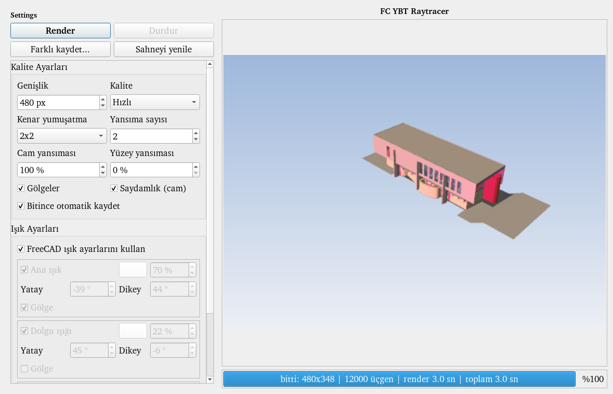
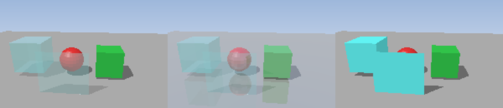
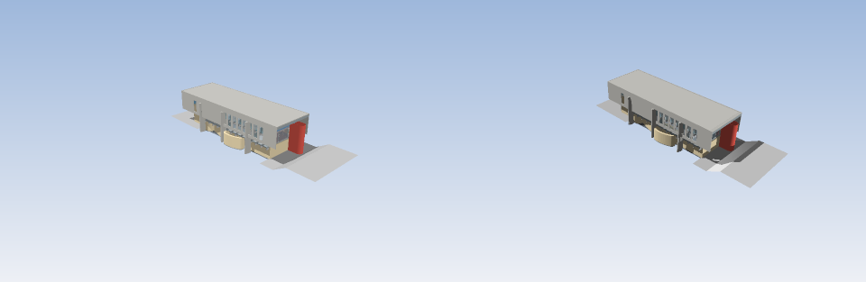

# FC YBT Raytracer

**TR** | [EN](#english)

FreeCAD için, **harici program gerektirmeyen** (yalnızca FreeCAD'in kendi Python'u ve numpy) hızlı bir ışın izleyici makrosu.
Aktif 3B görünümün kamerasından sahneyi render eder, önizlemeyi pencerede gösterir ve PNG olarak kaydeder.

## Özellikler

- Doğrudan ışık, gölge, ortam ışığı ve parlama (Whitted tarzı: gürültüsüz, hızlı)
- En çok 3 ışık: yatay/dikey açı, renk, güç, ışık başına gölge; ortam rengi/şiddeti
- **"FreeCAD ışık ayarlarını kullan"** seçeneği (seçiliyken kendi ışık ayarları devre dışı)
- Saydamlık (cam) ve Fresnel yansıması, isteğe bağlı yüzey yansıması
- Kenar yumuşatma (yalnızca kenar piksellerinde 2x2 / 3x3 / 4x4)
- 4 kalite kademesi (Low, **Hızlı** varsayılan, ...); büyük montajlar için hızlı mod
- Büyük sahnelerde hızlandırma: ekran karoları, ışık ızgarası, küme hiyerarşisi, sahne önbelleği
- Part, Body, App::Part, App::Link, Assembly, BIM (Arch) kapsayıcıları; renkler `ShapeAppearance`'tan
- **Çok çekirdekli render** (Çekirdek: Otomatik/1/2/4; sonuç tek çekirdekle birebir aynı)
- Ayar paneli ile açılan pencere, alt kısımda ilerleme çubuğu, durdurma, farklı kaydet

## Kurulum

1. `FC_ybt_raytracer.FCMacro` dosyasını FreeCAD makro klasörüne kopyalayın
   (FreeCAD içinde *Macro > Macros...* penceresinde makro klasörü yolu görünür).
2. Bir belgeyi açın, 3B görünümü istediğiniz açıya getirin.
3. *Macro > Macros...* ile makroyu çalıştırın, ayarları seçip **Render**'a basın.

Pencere açıkken 3B görünümü çevirip tekrar **Render** alabilirsiniz (sahne önbelleğe alınır).
Sonuç PNG olarak kaydedilir; klasör yazılamazsa `~/Pictures` veya ev dizini kullanılır.

## Gereksinimler

FreeCAD 1.0 veya üstü (1.1 / 26.x ile denendi), numpy (FreeCAD ile birlikte gelir). Başka bağımlılık yoktur.

## Sınırlar

- Kırılma (Snell) yok; cam yalnızca saydam + Fresnel yansıması verir.
- Sahne hazırlığı (üçgenleme, karo/ızgara/küme ağacı) tek çekirdekte; çok büyük sahnelerde cam/yansıma yavaştır (düşük kalite kademesi önerilir).
- Malzeme parlaklığı/yansıtıcılığı henüz nesneden okunmuyor.

## Yol haritası

Malzemeden parlaklık/yansıma, yumuşak gölge / gökyüzü ışığı, ayarların hatırlanması, ışık ön ayarları, turntable animasyonu.

## Lisans

MIT, bkz. [LICENSE](LICENSE).

---

## English

A fast, **dependency-free** ray-tracer macro for FreeCAD (just FreeCAD's own Python and numpy). It renders the active 3D view from its camera, shows a live preview and saves a PNG.

### Features

- Direct light, shadows, ambient light and specular highlights (Whitted style: noise-free and fast)
- Up to 3 lights: horizontal/vertical angle, colour, power, per-light shadows; ambient colour/intensity
- **"Use FreeCAD light settings"** option (disables the macro's own lights when checked)
- Transparency (glass) with Fresnel reflection, optional surface reflection
- Edge-only anti-aliasing (2x2 / 3x3 / 4x4)
- 4 quality levels (Low, **Fast** default, ...), suited to large assemblies
- Large-scene acceleration: screen tiles, light-space grid, cluster hierarchy, scene cache
- Part, Body, App::Part, App::Link, Assembly and BIM (Arch) containers; colours from `ShapeAppearance`
- **Multi-core rendering** (Cores: Auto/1/2/4; output identical to single-core)
- Settings panel opens first; progress bar, stop button, save-as

### Install

1. Copy `FC_ybt_raytracer.FCMacro` into your FreeCAD macro folder (shown in *Macro > Macros...*).
2. Open a document and orient the 3D view.
3. Run the macro from *Macro > Macros...*, adjust settings, press **Render**.

You can rotate the 3D view while the window is open and press **Render** again; the scene is cached.

### Requirements

FreeCAD 1.0+ (tested with 1.1 / 26.x) and numpy (bundled with FreeCAD).

### Limitations

- No refraction (Snell); glass is transparent with Fresnel reflection only.
- Scene preparation (tessellation, tile/grid/cluster build) is single-threaded; glass/reflections on very large scenes are slow (use a lower quality level).
- Material shininess/reflectivity is not yet read from objects.

### Roadmap

Material-based shininess/reflection, soft shadows / sky light, remembered settings, light presets, turntable animation.

### License

MIT, see [LICENSE](LICENSE).
