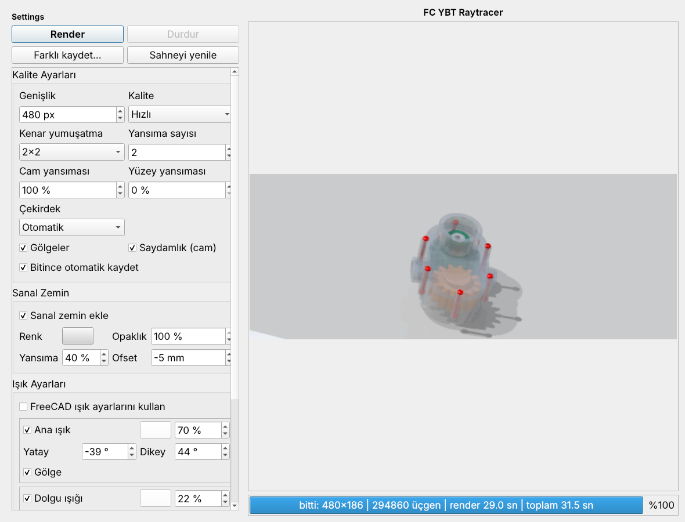
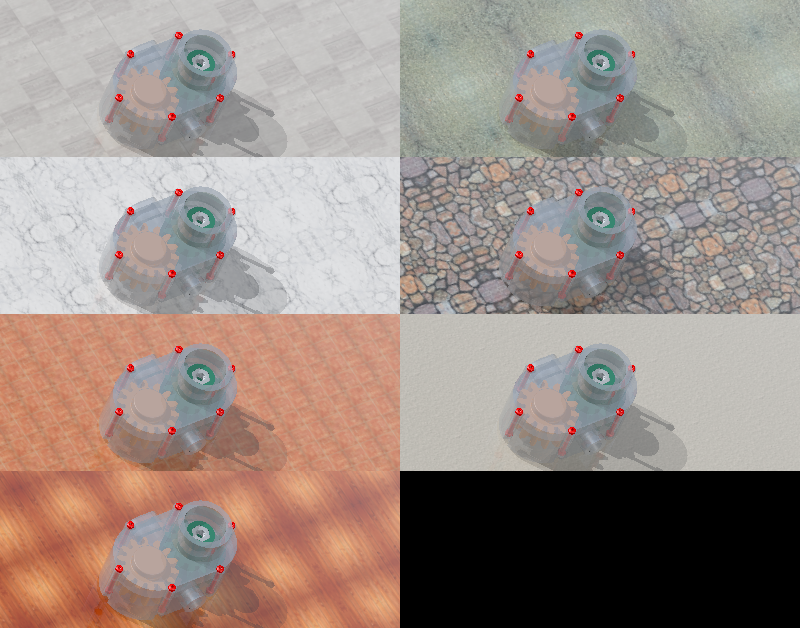
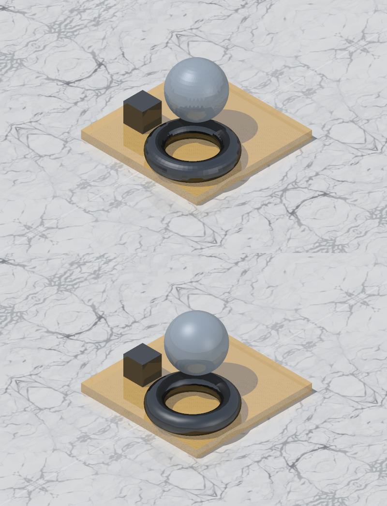
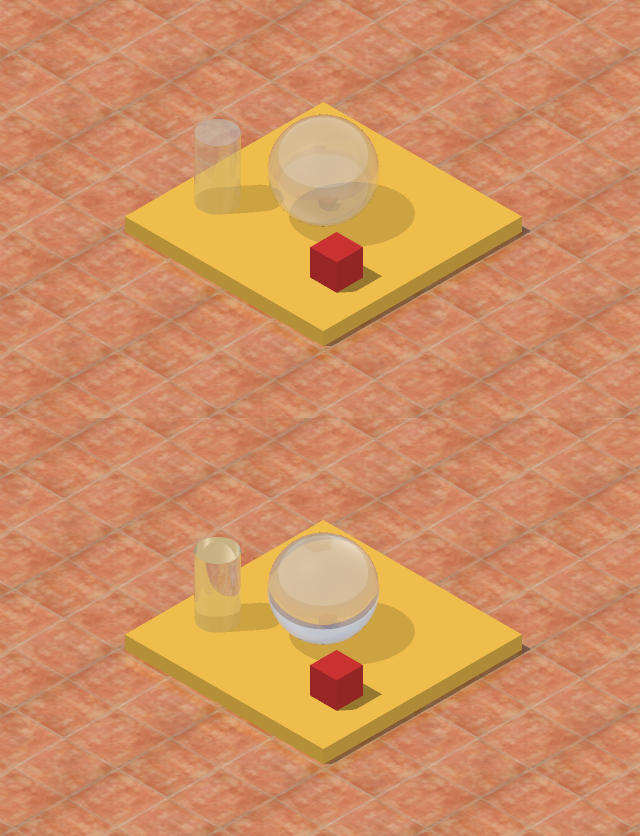

# FC YBT Raytracer

**TR** | [EN](#english)

FreeCAD için, **harici program gerektirmeyen** (yalnızca FreeCAD'in kendi Python'u ve numpy) hızlı bir ışın izleyici makrosu.
Aktif 3B görünümün kamerasından sahneyi render eder, önizlemeyi pencerede gösterir ve PNG olarak kaydeder.


## Özellikler

- Doğrudan ışık, gölge, ortam ışığı ve parlama (Whitted tarzı: gürültüsüz, hızlı)
- En çok 3 ışık: yatay/dikey açı, renk, güç, ışık başına gölge; ortam rengi/şiddeti
- **"FreeCAD ışık ayarlarını kullan"** seçeneği (seçiliyken kendi ışık ayarları devre dışı)
- Saydamlık (cam), Fresnel yansıması ve **cam kırılması** (Snell yasası, kırılma indisi ayarlanır), isteğe bağlı yüzey yansıması
- **Yumuşak yüzeyler**: küre/simit/silindir pürüzsüz gölgelenir, keskin kenarlar korunur
- **Sanal zemin**: sahnenin en altına otomatik yerleşir; renk, opaklık, yansıma ve yükseklik ofseti ayarlanır; **7 hazır doku** (travertin, çakıl, mermer, taş, terrakota, sıva, ahşap) ya da kendi görüntünüz
- Kenar yumuşatma (yalnızca kenar piksellerinde 2x2 / 3x3 / 4x4)
- 4 kalite kademesi (Low, **Hızlı** varsayılan, ...); büyük montajlar için hızlı mod
- Büyük sahnelerde hızlandırma: ekran karoları, otomatik boyutlu ışık ızgarası, küme hiyerarşisi, sahne önbelleği
- Part, Body, App::Part, App::Link, Assembly, BIM (Arch) kapsayıcıları; renkler `ShapeAppearance`'tan
- **Çok çekirdekli render** (Çekirdek: Otomatik/1/2/4; Linux'ta ayrı süreçler, sonuç tek çekirdekle birebir aynı)
- **Mesh nesneleri** (`Mesh::Feature`: STL/OBJ içe aktarma, Şekil→Mesh): üçgenler üçgenleme gerekmeden doğrudan kullanılır; App::Part / Link içinde de doğru konumlanır, malzeme atanabilir
- **"Render'a dahil et"** kutusu: Malzemeler (Surface) penceresindeki nesne listesinde her nesnenin onay kutusu; kutusu kaldırılan nesne sahneye hiç girmez (gölge/yansıma da vermez)
- **"Kadraj dışındaki nesneleri atla"** seçeneği: kameranın görmediği nesneler üçgenlenmez ve sahne boyutuna katılmaz (büyük modelde yakın plan çekimlerde hızlandırır)
- **Arayüzsüz API** (`ybt_raytracer.api`): panel açmadan render, **turntable** ve hareketli parça **animasyonu** (aşağıya bakın)
- Ayar paneli ile açılan pencere, alt kısımda ilerleme çubuğu, durdurma, farklı kaydet








## Dil / Language
Panelin sağ üstündeki "Dil / Language" kutusundan Türkçe veya English seçilir; seçim hatırlanır (ilk açılışta FreeCAD arayüz dili Türkçeyse Türkçe, değilse English).
The UI language (Türkçe / English) is chosen at the top-right of the panel; it is remembered (first run follows FreeCAD's locale).

## Kurulum

1. `FC_ybt_raytracer.FCMacro` dosyasını **ve** `ybt_raytracer/` klasörünü FreeCAD makro klasörüne birlikte kopyalayın
   (FreeCAD içinde *Macro > Macros...* penceresinde makro klasörü yolu görünür). Başlatıcı ile klasör yan yana durmalıdır.
2. Bir belgeyi açın, 3B görünümü istediğiniz açıya getirin.
3. *Macro > Macros...* ile makroyu çalıştırın, ayarları seçip **Render**'a basın.

Pencere açıkken 3B görünümü çevirip tekrar **Render** alabilirsiniz (sahne önbelleğe alınır).
Sonuç PNG olarak kaydedilir; klasör yazılamazsa `~/Pictures` veya ev dizini kullanılır.

## Gereksinimler

FreeCAD 1.0 veya üstü (1.1 / 26.x ile denendi), numpy (FreeCAD ile birlikte gelir). Başka bağımlılık yoktur.

## Arayüzsüz kullanım ve animasyon

Panel açmadan, makrodan ya da FreeCAD Python konsolundan:

```python
from ybt_raytracer import api
api.render_document(App.ActiveDocument, "/tmp/sahne.png", width=1280, floor=True, aa=3)

# turntable: kamera sahnenin çevresinde döner (sahne bir kez hazırlanır)
doc = App.ActiveDocument
scene = api.prepare_scene(doc)
for i, cam in enumerate(api.orbit_cameras(scene, frames=72, elevation=20)):
    api.render_document(doc, "/tmp/kare_%04d.png" % i, width=960, camera=cam, scene=scene)

# hareketli parçalar: şekiller bir kez üçgenlenir, her karede yalnız yerleşim uygulanır
cache = {}
for i in range(72):
    nesne.Placement = ...; doc.recompute()
    api.render_document(doc, "/tmp/kare_%04d.png" % i, width=960, camera=cam, tess_cache=cache)
```

Ayarlar `settings.py` adlarıyla (küçük harf) anahtar sözcük olarak verilir ve yalnız o çağrı için geçerlidir (`floor=True, shadows=False, aa=4, tess_factor=0.002, cull_offscreen=True ...`).
Kamera: `api.make_camera(pos, target, fov=40)`, `api.fit_camera(scene)`, `api.orbit_cameras(...)`. Arayüzsüz FreeCAD'de (`freecadcmd`) kamera verilmezse sahneyi sığdıran izometrik kamera kullanılır.
Şekil parametreleri değişirse `tess_cache` için yeni bir sözlük verin. Hazır örnek: [`examples/FC_ybt_turntable.FCMacro`](examples/FC_ybt_turntable.FCMacro) (kamera turntable'ı ya da dönen parça; kare dizisi → `ffmpeg` ile video).

## Sınırlar

- Mesh nesnelerinde köşe renkleri (vertex colors) kullanılmaz; nesnenin tek rengi/malzemesi uygulanır.
- Kırılma yalnızca saydam yüzeylerde ve kapalı gövdelerde (küre, silindir, kutu) doğru çalışır; cam altında ışık odaklanması (kostik) yok, gölge camdan yarı saydam geçer.
- Zemin dokularının bir kısmı (çakıl, mermer, taş, ahşap) kenarlardan aynalanarak tekrarlanır; geniş zeminde simetri fark edilebilir.
- Sahne hazırlığı (üçgenleme, karo/ızgara/küme ağacı) tek çekirdekte; çok büyük sahnelerde cam/yansıma yavaştır (düşük kalite kademesi önerilir).
- Malzeme parlaklığı/yansıtıcılığı henüz nesneden okunmuyor.

## Yol haritası

Metal yansıma rengi, nesne dokuları, yumuşak gölge / gökyüzü ışığı, ayarların hatırlanması, ışık ön ayarları, daha hızlı sahne hazırlığı.

## Lisans

MIT, bkz. [LICENSE](LICENSE).

---

## English

A fast, **dependency-free** ray-tracer macro for FreeCAD (just FreeCAD's own Python and numpy). It renders the active 3D view from its camera, shows a live preview and saves a PNG.

### Features

- Direct light, shadows, ambient light and specular highlights (Whitted style: noise-free and fast)
- Up to 3 lights: horizontal/vertical angle, colour, power, per-light shadows; ambient colour/intensity
- **"Use FreeCAD light settings"** option (disables the macro's own lights when checked)
- Transparency (glass) with Fresnel reflection and **refraction** (Snell's law, adjustable IOR), optional surface reflection
- **Smooth surfaces**: spheres/tori/cylinders shaded smoothly, sharp edges preserved
- **Virtual floor**: placed at the scene's lowest point automatically; colour, opacity, reflection and height offset adjustable; **7 built-in textures** (travertine, gravel, marble, stone, terracotta, plaster, wood) or your own image
- Edge-only anti-aliasing (2x2 / 3x3 / 4x4)
- 4 quality levels (Low, **Fast** default, ...), suited to large assemblies
- Large-scene acceleration: screen tiles, auto-sized light-space grid, cluster hierarchy, scene cache
- Part, Body, App::Part, App::Link, Assembly and BIM (Arch) containers; colours from `ShapeAppearance`
- **Multi-core rendering** (Cores: Auto/1/2/4; output identical to single-core)
- **Mesh objects** (`Mesh::Feature`: STL/OBJ import, Shape→Mesh): triangles are used directly, no tessellation; correctly placed inside App::Part / Link; materials can be assigned
- **"Include in render"** checkbox per object in the Materials (Surface) window's object list; unchecked objects are left out of the scene entirely (no shadows/reflections either)
- **"Skip objects outside the frame"** option: objects the camera cannot see are not tessellated and do not count toward the scene size (speeds up close-ups of large models)
- **Headless API** (`ybt_raytracer.api`): render without opening the panel, **turntable** and moving-part **animation** (see below)
- Settings panel opens first; progress bar, stop button, save-as

### Install

1. Copy `FC_ybt_raytracer.FCMacro` **and** the `ybt_raytracer/` folder together into your FreeCAD macro folder (shown in *Macro > Macros...*); the launcher and the folder must sit side by side.
2. Open a document and orient the 3D view.
3. Run the macro from *Macro > Macros...*, adjust settings, press **Render**.

You can rotate the 3D view while the window is open and press **Render** again; the scene is cached.

### Requirements

FreeCAD 1.0+ (tested with 1.1 / 26.x) and numpy (bundled with FreeCAD).

### Headless API and animation

Without opening the panel, from a macro or FreeCAD's Python console:

```python
from ybt_raytracer import api
api.render_document(App.ActiveDocument, "/tmp/scene.png", width=1280, floor=True, aa=3)

# turntable: the camera orbits the scene (scene is prepared once)
doc = App.ActiveDocument
scene = api.prepare_scene(doc)
for i, cam in enumerate(api.orbit_cameras(scene, frames=72, elevation=20)):
    api.render_document(doc, "/tmp/frame_%04d.png" % i, width=960, camera=cam, scene=scene)

# moving parts: shapes are tessellated once, only their placement is applied each frame
cache = {}
for i in range(72):
    obj.Placement = ...; doc.recompute()
    api.render_document(doc, "/tmp/frame_%04d.png" % i, width=960, camera=cam, tess_cache=cache)
```

Settings are passed as keyword arguments named like `settings.py` (lower case) and apply to that call only (`floor=True, shadows=False, aa=4, tess_factor=0.002, cull_offscreen=True ...`).
Cameras: `api.make_camera(pos, target, fov=40)`, `api.fit_camera(scene)`, `api.orbit_cameras(...)`. In headless FreeCAD (`freecadcmd`) an isometric camera fitting the scene is used when no camera is given.
Pass a fresh dict as `tess_cache` when shape parameters change. Ready-made example: [`examples/FC_ybt_turntable.FCMacro`](examples/FC_ybt_turntable.FCMacro) (camera turntable or rotating part; frame sequence → video with `ffmpeg`).

### Limitations

- Mesh vertex colors are not used; the object's single colour/material applies.
- Refraction works best on transparent closed bodies (sphere, cylinder, box); no caustics, shadows pass through glass as partial shade.
- Some floor textures (gravel, marble, stone, wood) tile by mirroring, so symmetry may show on a large floor.
- Scene preparation (tessellation, tile/grid/cluster build) is single-threaded; glass/reflections on very large scenes are slow (use a lower quality level).
- Material shininess/reflectivity is not yet read from objects.

### Roadmap

Metal reflection colour, object textures, soft shadows / sky light, remembered settings, light presets, faster scene preparation.

### License

MIT, see [LICENSE](LICENSE).


## Zemin dokuları / Floor textures

Sanal zemin için hazır dokular: travertin, çakıl, beyaz mermer, taş kaplama, terrakota, sıva, ahşap; ayrıca *Dosyadan…* ile kendi PNG/JPG görüntünüz. *Doku boyu* ile ölçek ayarlanır.
Ready-made floor textures (7) or your own image via *Dosyadan…*; *Doku boyu* sets the scale.

## Kod yapısı / Code layout

```
FC_ybt_raytracer.FCMacro     ince başlatıcı / thin launcher
ybt_raytracer/
  settings.py        ayarlar / settings
  core.py            Scene + kesişim / intersection
  parallel.py        BLAS sınırı, iptal, ilerleme / BLAS limit, cancel, ticker
  accel.py           karo, ışık ızgarası, küme hızlandırıcılar / accelerators
  render.py          ışın izleme döngüsü / ray-tracing loop
  output.py          PNG yazıcı / PNG writer
  freecad_scene.py   FreeCAD -> üçgen, kamera, ışıklar / FreeCAD scene import
  ui.py              ayar paneli / settings panel
  materials.py       malzeme kütüphanesi, dahil et işareti / materials, include flag
  surface_ui.py      malzeme penceresi / material window
  api.py             arayüzsüz API, animasyon / headless API, animation
examples/
  FC_ybt_turntable.FCMacro   animasyon örneği / animation example
CHANGELOG.md
```
